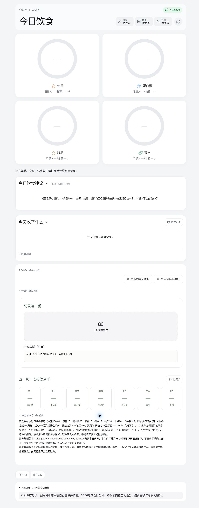
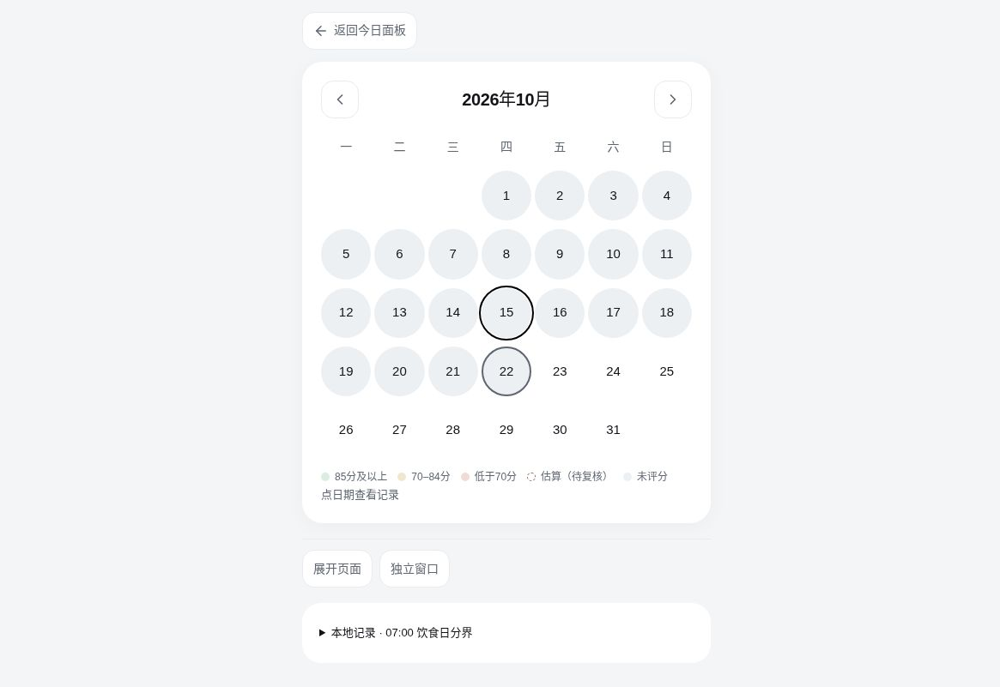

# Healthy Eating Dashboard

[简体中文](README.md) · [Project operating contract](SKILL.md)

A local-first food diary, nutrition-estimation, and history viewer built with FastAPI, SQLite, and React. The application starts with **empty user data**: no personal database, meal or weight records, personal targets, account credentials, or hosted deployment are bundled. All screenshots below use a fresh, empty data directory and contain no personal dietary data.

The interface is primarily Chinese; this English README does not imply a fully translated UI.

## What is included

- Storage for your own dated profile facts, preferences, meals, product labels, and structured analyses with provenance.
- Separate actual intake, proposed menus, recipe references, and nutrition reference data. Generic composition data is not anyone's food diary.
- Nutrition calculations/estimates, structured candidate validation, history, and audit records. Built-in menu generation supports only limited generic recipe templates, not general intelligent meal planning; other dishes require operator-supplied, validated structured candidates.
- **No AI model, image-recognition service, chat connector, or internal scheduler.** Uploading a photo does not analyze it. Analysis-related controls do not provide an automatic recognition service out of the box.
- No preinstalled daily job. A configured 07:00 time is a policy boundary, not a scheduled task.
- An empty/unrecorded day means missing evidence, not zero intake, skipped meals, or fasting.
- This is a personal recordkeeping tool, not medical diagnosis or a prescription. Estimates, targets, and scores are not precise measurements or clinical conclusions.

## Complete empty dashboard

This full dashboard was captured from the running application with a fresh, empty data directory. It is not a cropped detail and contains no demonstration meals, personal targets, or weight records. Empty fields mean information is unavailable, not zero intake or fasting. Nutrient-ring target progress and the daily score are different concepts.



## Empty history view

This history-page screenshot was captured from the running app with a fresh, empty data directory. It contains no personal meal, weight, or score records.



## Start from scratch

### 1. Install and launch

You need Python 3.11+, Node.js 22.12+, npm, and Git. Linux is recommended; macOS can use the same commands but should be validated in your environment. The CLI uses Unix `fcntl` locks, so native Windows is unsupported; use WSL/Linux instead. Your system needs `Asia/Shanghai` timezone data.

Clone this repository and enter its root directory. Initial installation needs access to Python and npm package registries:

```bash
bash scripts/setup.sh
bash scripts/start.sh
```

The setup script creates `.venv`, installs dependencies, and builds the frontend. `requirements.lock` pins the full Python dependency versions; npm uses `package-lock.json`. Equivalent manual installation:

```bash
python3 -m venv .venv
.venv/bin/python -m pip install -r requirements.lock
npm --prefix apps/web ci
npm --prefix apps/web run build
bash scripts/start.sh
```

Open **http://127.0.0.1:8765/diet/health** in your browser. Keep the terminal running; Ctrl+C stops the service. First startup creates the data directories and database automatically. You do not need another person's data or manual SQL migrations.

### 2. Add your own information

1. Open “个人资料与喜好” (Profile and preferences). Enter your own facts and goal direction, using the actual measurement date. Leave unknown fields blank.
2. Add your own preferences, dietary restrictions, and activity context. Incomplete information may leave targets or recommendations unavailable; this is expected.
3. Record actual meals through the local API or structured CLI ingestion below. Photos may be attached, but you or a separately authorized integration must supply structured nutrition analysis for local validation and writeback.
4. Use `target-set` if you explicitly choose dated daily nutrient targets. Not running it does not import a preset personal target; do not fabricate missing values.

Recipe seeds are disabled by default (`recipe_seed: "none"`). Optional bundled generic recipe seeds provide candidate combinations only, not preferences, actual intake, or individual nutrition targets.

### 3. Check status

In another terminal, from the repository root:

```bash
.venv/bin/python scripts/diet_cli.py health
.venv/bin/python scripts/diet_cli.py overview
.venv/bin/python scripts/diet_cli.py targets
```

The CLI calls the local application in-process without starting another network listener. An offline worker/provider in `health` does not mean the database is broken: this project does not run a background AI worker or scheduling service.

## Storage and privacy

The default data root is `data/` under the repository. Change `data_root` in `config.json`, or preferably use `PDP_DATA_ROOT` to store private data outside the repository. The environment variable takes precedence. Use the same absolute location for the server and CLI:

```bash
export PDP_DATA_ROOT="$HOME/.local/share/healthy-eating"
bash scripts/start.sh
# Set the same variable in other terminals, or pass --data-root to the CLI.
.venv/bin/python scripts/diet_cli.py --data-root "$HOME/.local/share/healthy-eating" overview
```

- `DATA/database/platform.sqlite3`: authoritative source of records, analyses, target versions, settings, audit, and runtime state. SQLite uses WAL; `-wal` and `-shm` files may exist during operation.
- `DATA/assets/`: uploaded local images/files, referenced and checksummed by the database.
- `DATA/reference_materials/` and `DATA/planning_audits/`: private reference materials and planning audit files created by the corresponding features.
- `DATA/exports/`, `DATA/backups/`, `DATA/runtime/`, and `DATA/agent-work/`: export/runtime support directories, not a second authoritative database.
- `apps/api/app/data/`: bundled generic reference data, distinct from private `DATA`.
- Browser local storage is used for display preferences; clearing browser storage does not delete server-side records.

Local files are **not encrypted at rest by the application**. Protect them with OS account permissions, disk encryption, and secure backups. Git ignore rules prevent accidental commits; they are not access controls. Ensure a custom data directory also stays out of Git.

The default service is local-only, not a public-ready multi-user deployment. Do not expose the listener, add a tunnel, or publish private records as a shortcut to synchronization.

### Optional snapshot export, not cloud sync

`mirror_transport` defaults to `disabled`. All mirror compatibility interfaces return disabled status only: they neither generate snapshots nor push data to an external server. Local snapshots require explicitly running the standalone exporter. The proprietary connector used in another environment is not bundled and is not installed by this project.

Inspect the standalone read-only exporter's options:

```bash
.venv/bin/python scripts/diet_mirror_export.py --help
.venv/bin/python scripts/diet_cli.py mirror-status
```

An exported snapshot may still contain private health information even when some identifiers are removed. Do not commit it or host it publicly. A snapshot is not a complete backup.

## CLI and structured operations

Use actual `--help`, Pydantic schemas, and freshly returned versions. Never guess record IDs, versions, or idempotency keys:

```bash
.venv/bin/python scripts/diet_cli.py --help
.venv/bin/python scripts/diet_cli.py ingest --help
.venv/bin/python scripts/diet_cli.py analysis --help
.venv/bin/python scripts/diet_cli.py target-set --help
```

Main commands:

- Read: `health`, `overview`, `targets`, `target-review-status`, `target-review-context`.
- Actual records: `ingest --input <JSON-file>`, followed by `analysis --meal-id <record-ID> --input <JSON-file>` for analysis writeback.
- Product labels: `food-match`, `food-save`, `food-versions`, `food-calculate`. Saving a label or calculating a portion does not record consumption.
- Targets: `target-set --input <JSON-file>` and explicit review operations `target-review-enable`, `target-review-commit`.
- Menus: `planning-context --date YYYY-MM-DD`, `plan-preview --date YYYY-MM-DD`, `validate-plan --input <JSON-file>`, `publish-candidate --input <JSON-file>`, `revise-remaining --input <JSON-file>`.
- Settlement: `settle --date YYYY-MM-DD` is subject to the 07:00 policy and evidence requirements. It is not a scheduler and cannot guarantee a menu/score from missing data. The deprecated `--score-only` flag is rejected.

The top-level ingestion fields are `channel`, `message_id`, `images`, and `meal`, with optional `analysis`. Images use local absolute paths. `meal` follows the `Meal` model in `apps/api/app/schemas.py`; timestamps must include a timezone. Channel/message ID pairs are idempotent identities, not reusable labels for different meal content.

Standalone analysis requires the complete `AnalysisWrite` envelope in `apps/api/app/external_api.py`: current version, image references and hashes, idempotency key, and `MealVisionOutput`. Targets follow `TargetWrite` in `apps/api/app/diet_targets.py`. Missing evidence must stay unknown, not become zero merely to pass validation.

The CLI returns JSON. Ordinary errors use exit code 2; conflicts use 3. Reread current state before resolving a conflict instead of blindly repeating writes.

### Optional: try structured ingestion in an isolated directory

This is a wholly fictional test meal, not a food recommendation or real history. Running these commands writes only to a newly created temporary data directory, not your regular diary. Nutrition values are deliberately omitted: successful ingestion does not mean analysis is complete. For real use, supply actual consumed food, the correct date, and a distinct message identity.

```bash
DEMO_ROOT="$(mktemp -d)"
cat > "$DEMO_ROOT/meal.json" <<'JSON'
{
  "channel": "local-demo",
  "message_id": "synthetic-example-001",
  "images": [],
  "meal": {
    "eaten_at": "2030-01-01T12:00:00+08:00",
    "diet_date": "2030-01-01",
    "meal_type": "午餐",
    "title": "Synthetic demonstration meal",
    "notes": "Fictional test only; no nutrition or portion evidence.",
    "status": "pending"
  }
}
JSON
.venv/bin/python scripts/diet_cli.py --data-root "$DEMO_ROOT/data" ingest --input "$DEMO_ROOT/meal.json"
.venv/bin/python scripts/diet_cli.py --data-root "$DEMO_ROOT/data" overview
```

You may remove the temporary directory after testing; do not configure it as your production data root. Interactive local API documentation is at http://127.0.0.1:8765/api/docs .

## Dates, scores, and automation limits

- The diet day is fixed to **07:00 Asia/Shanghai through 07:00 the next day**. Explicit record dates take precedence; do not casually rewrite historical attribution.
- This is not a universal-timezone product. Changing `timezone` in `config.json` does not migrate diet-day, publication, or scoring rules.
- Formal publication and settlement of the previous complete diet day follow the 07:00 policy. Same-day formal results are reused; previews are not promoted automatically; planned menus never become actual intake by implication.
- External scheduling or analysis integrations require separate implementation, testing, and authorization. The repository neither schedules execution nor calls models automatically.
- Scores use a fixed **100-point denominator**, without renormalizing missing components. Display colors are **green at ≥85, yellow at ≥70, and red below 70**. An unavailable score remains unknown, not an invented zero.
- Estimates retain ranges, sources, and estimate labels. Scores describe target adherence and food structure, not disease risk or clinical pass/fail thresholds.

## v8 scoring rules (effective 2026-10-23)

The current version is `diet-quality-v8-continuous-tolerance`, effective for **2026-10-23** onward by Asia/Shanghai diet date:

- Seven components total 100 points: energy 25, protein 20, fat 15, carbohydrates 15, vegetables 10, fruit 10, whole grains/mixed beans 5.
- For each macro/energy component, deviation is `d = abs(intake / target - 1)`. Deviation ≤5% earns full points; points fall linearly between 5% and 40%; deviation ≥40% earns zero for that component. Above-target and below-target deviations are symmetric.
- Vegetables, fruit, and whole grains/mixed beans use references of 300g raw edible weight, 200g edible weight, and 50g dry ingredient weight respectively. Points scale with the fraction achieved and are capped at full points, with no excess penalty. Unknown portions are not evidence of no consumption.
- Add all seven components, then retain the alcohol deduction of 1 point per 3g pure alcohol, capped at 30 points. The total cannot fall below zero. No dimensions are dropped, no renormalization is applied, and there is no additional 79-point cap.
- Saved v6/v7 scores, weights, explanations, and versioned estimates remain unchanged; upgrading does not authorize rewriting personal history.

These are software heuristics, not a clinically validated health index. Existing evidence, applicability, and missing-data safeguards still apply. See [full formulas, examples, and version boundaries](docs/diet-quality-scoring.md).

## Backup and restore

Do not copy only an actively used SQLite main file. The CLI creates a consistent database snapshot plus database-referenced assets, reference materials, planning audits, and a checksum manifest. Source code is not included: preserve a matching code version separately. Restore verifies source-file hashes, including configuration, policy, and SKILL.

```bash
mkdir -p "$HOME/healthy-eating-backups"
.venv/bin/python scripts/diet_cli.py backup --output "$HOME/healthy-eating-backups/snapshot-001"
.venv/bin/python scripts/diet_cli.py restore --input "$HOME/healthy-eating-backups/snapshot-001" --target "$HOME/healthy-eating-restored"
```

Backup destinations and restore targets must be **new, nonexistent directories** with existing parents. After restoring, stop the old service, point `PDP_DATA_ROOT` at the restored directory, restart, and verify `overview` and attachments. These names are path examples only, not personal data.

Complete recovery needs a data backup plus matching source/configuration, not a screenshot or viewer snapshot. Backups may retain historical versions and audit records and remain sensitive; never upload them to GitHub. Back up and test restoration before upgrading.

## Which skills are required?

This repository includes exactly **one project-owned skill: [`SKILL.md`](SKILL.md)**. It documents evidence collection/classification, structured analysis writeback, candidate validation, and publication. The software reads and hashes it to bind planning context to policy versions.

It is an ordinary Markdown operating contract, not an installed autonomous assistant. It does not supply a model, scheduler, account access, or connector. No internal assistant/runtime skills are required or distributed. `apps/api/app/diet_policy.json` is the structured software policy, not a second skill.

## Development and troubleshooting

```bash
.venv/bin/python -m pytest -q
.venv/bin/python scripts/audit_distribution.py
npm --prefix apps/web run typecheck
npm --prefix apps/web test
npm --prefix apps/web run build
```

- Frontend not built: run the build command, then restart/refresh.
- Port occupied: stop the conflicting process or set `PDP_PORT`, restart, and browse the chosen port.
- Photo exists but analysis is absent: expected until valid structured analysis is supplied; there is no bundled model-key switch.
- No menu/target/score: check missing profile/evidence, target date, and publication conditions.
- Restore reports a source mismatch: use the backup's matching code/configuration instead of bypassing integrity checks.

No open-source license has been selected. Public visibility does not itself grant unrestricted copying, modification, or redistribution. Third-party dependencies retain their own licenses.
